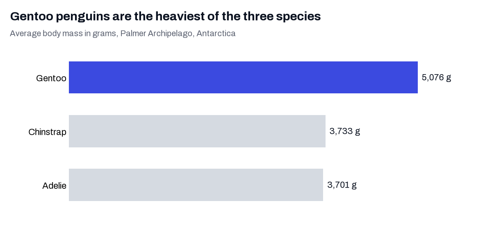

# Penguin weights

**Gentoo penguins are the heaviest of three species: 5,076 grams on average, over 1.3 kg more than the other two.**

*Practice project from a GitHub class. The data, the SQL and the chart were supplied; this page is mine.*
